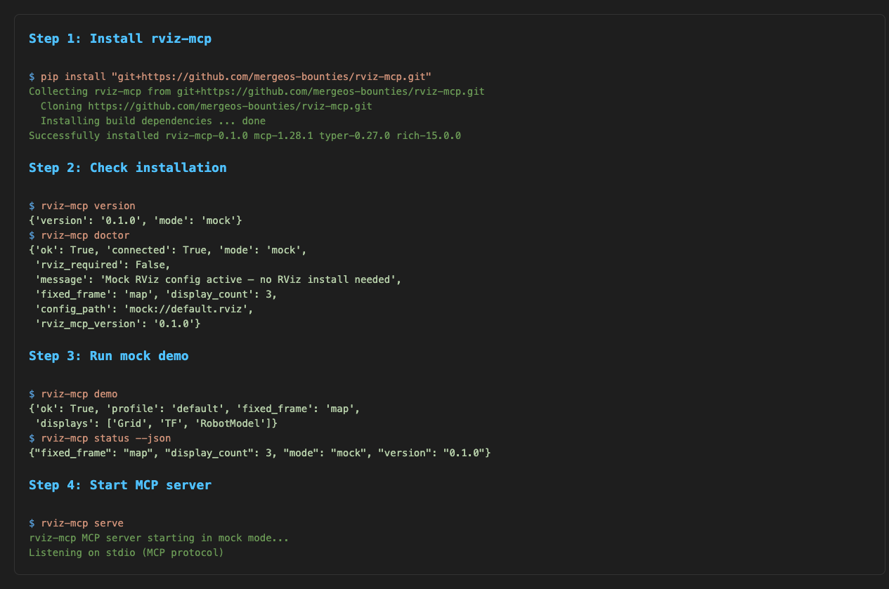
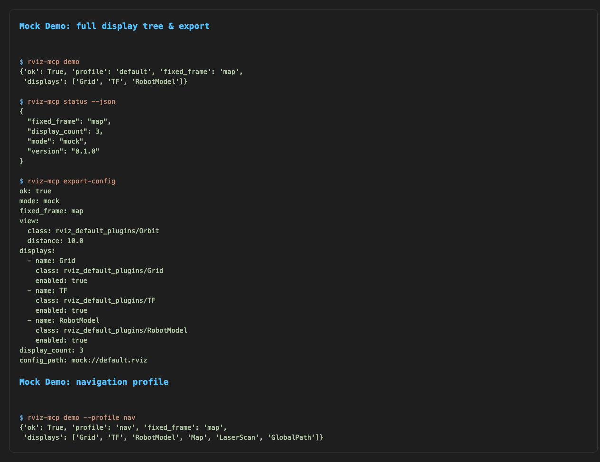
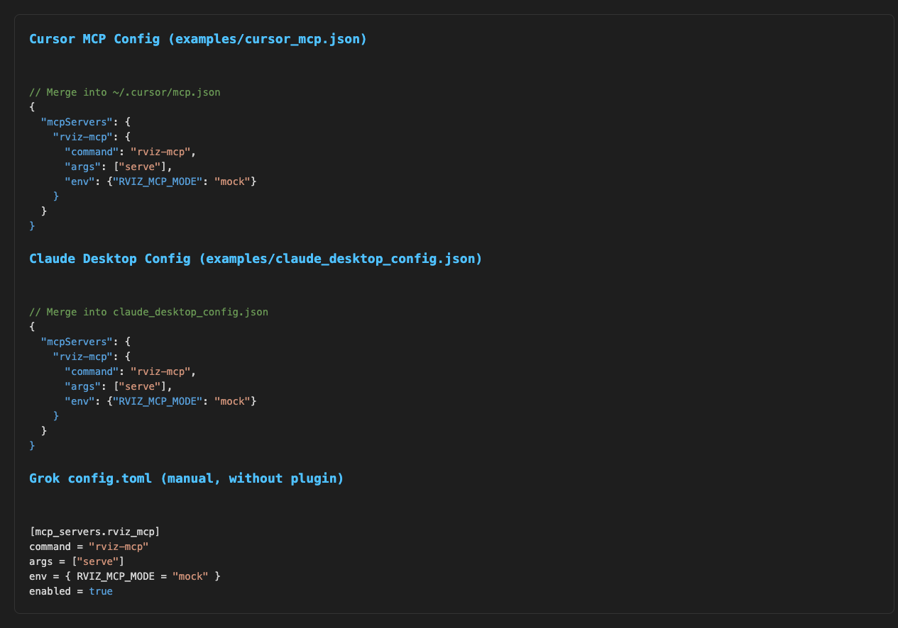

# Host MCP Setup Guide

This guide walks you through installing and configuring `rviz-mcp` on your development machine for use with **Cursor**, **Claude Desktop**, and **Grok**.

---

## 1. Install `rviz-mcp`

Install the Python package from the GitHub repository:

```bash
pip install "git+https://github.com/mergeos-bounties/rviz-mcp.git"
```



*Figure 1: Installation output showing package download, build, and successful install.*

After installation, verify everything is working:

```bash
rviz-mcp version     # → {'version': '0.1.0', 'mode': 'mock'}
rviz-mcp doctor      # → health check — no RViz install needed
rviz-mcp demo        # → seeds a default mock display tree
rviz-mcp status --json  # → current mock state
```

---

## 2. Run a Mock Demo

The mock mode works entirely offline — no ROS 2 or RViz2 installation required.

```bash
rviz-mcp demo
rviz-mcp status --json
rviz-mcp export-config
```



*Figure 2: Mock demo session showing the default display tree (Grid, TF, RobotModel), status JSON, and exported YAML config.*

Try the navigation profile for a richer display tree:

```bash
rviz-mcp demo --profile nav
```

---

## 3. Configure MCP Clients

`rviz-mcp` speaks the MCP protocol over **stdio**. Point any MCP host at the `rviz-mcp serve` command.

All three clients share the same server configuration:

| Field | Value |
|-------|-------|
| command | `rviz-mcp` |
| args | `["serve"]` |
| env | `{ "RVIZ_MCP_MODE": "mock" }` |



*Figure 3: MCP configuration snippets for Cursor, Claude Desktop, and Grok.*

### Cursor

Merge into `~/.cursor/mcp.json` (or your project `.cursor/mcp.json`):

```json
{
  "mcpServers": {
    "rviz-mcp": {
      "command": "rviz-mcp",
      "args": ["serve"],
      "env": { "RVIZ_MCP_MODE": "mock" }
    }
  }
}
```

### Claude Desktop

Merge into `claude_desktop_config.json` (Claude → Settings → Developer → Edit Config):

```json
{
  "mcpServers": {
    "rviz-mcp": {
      "command": "rviz-mcp",
      "args": ["serve"],
      "env": { "RVIZ_MCP_MODE": "mock" }
    }
  }
}
```

### Grok (Manual — without plugin)

Add to `~/.grok/config.toml` or project `.grok/config.toml`:

```toml
[mcp_servers.rviz_mcp]
command = "rviz-mcp"
args = ["serve"]
env = { RVIZ_MCP_MODE = "mock" }
enabled = true
```

> **Grok plugin (recommended):** If you use the Grok CLI, the one-liner below handles both the install and registration:
> ```bash
> pip install "git+https://github.com/mergeos-bounties/rviz-mcp.git" && grok plugin install mergeos-bounties/rviz-mcp --trust
> ```

### Generic stdio MCP (any host)

For Claude Code, VS Code (MCP / Continue / Cline), Windsurf, Codex CLI, or any MCP-compatible host:

```
command: rviz-mcp
args:    ["serve"]
env:     { "RVIZ_MCP_MODE": "mock" }
```

---

## 4. Start the Server

Once configured, start the server:

```bash
rviz-mcp serve
```

The server listens on **stdio** and exposes these tools to your AI agent:

| Tool | Purpose |
|------|---------|
| `rviz_doctor` | Connectivity / config health |
| `rviz_seed_demo` | Reset mock displays (Grid, TF, RobotModel) |
| `rviz_list_displays` | Current display tree |
| `rviz_add_display` / `rviz_remove_display` | Manage displays |
| `rviz_set_fixed_frame` | Change fixed frame (e.g. `map`, `odom`) |
| `rviz_set_view` | View controller type + look-at |
| `rviz_load_config` / `rviz_save_config` | Config path |
| `rviz_screenshot` | Mock screenshot path |
| `rviz_export_config` | Export mock config as YAML |

Your AI agent can call any of these tools via the MCP protocol to inspect and control the RViz virtual display tree.

---

## 5. Live Mode (optional)

For integration with a real RViz2 instance running alongside a bridge, set `RVIZ_MCP_MODE=live` and point to the bridge:

```bash
export RVIZ_MCP_MODE=live
export RVIZ_MCP_BRIDGE_URL="http://127.0.0.1:8765"
rviz-mcp doctor
```

See [LIVE_BRIDGE.md](LIVE_BRIDGE.md) for the full HTTP contract.

---

## 6. Troubleshooting

| Symptom | Check |
|---------|-------|
| `command not found: rviz-mcp` | Ensure `pip install` completed and the Python Scripts folder is on your `PATH` |
| `rviz-mcp doctor` reports `ok: false` | Run in mock mode (default) — no external dependencies needed |
| MCP client can't find the server | Verify the config JSON/TOML syntax and that `rviz-mcp serve` works in your terminal first |
| Server starts but tools don't appear | Restart the MCP client (some cache the tool list on connect) |

---

*For development instructions, see the [main README](../README.md).*
